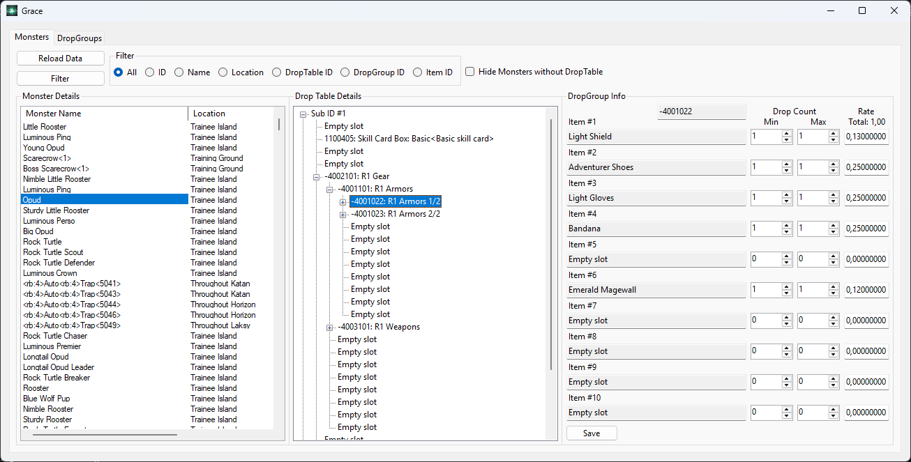
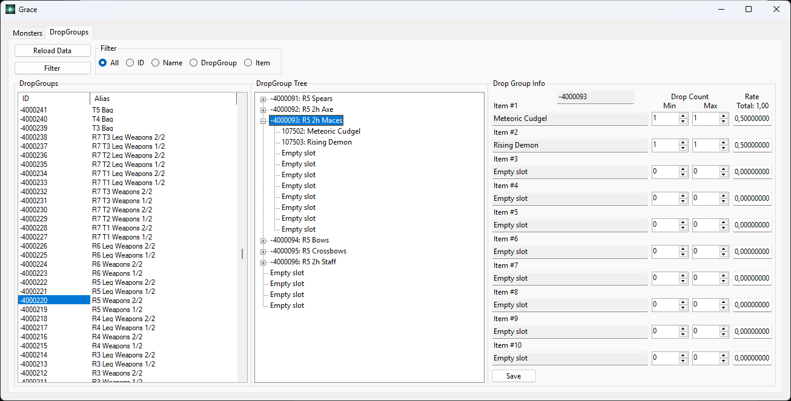
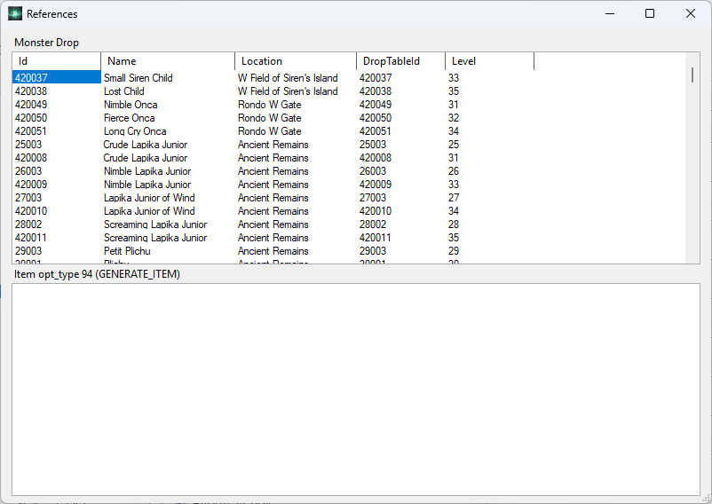

# Grace

Grace is a Windows desktop tool for browsing and editing Rappelz drop data stored in a SQL Server database.

It provides a WinForms UI for inspecting monster drop tables, navigating nested drop groups, editing drop counts and rates, and finding references between monsters, items, and drop groups.

## Screenshots

### Monster Drop Tables



### Drop Groups



### References



## Features

- Browse monsters with names, locations, levels, and drop table IDs.
- Inspect nested drop table and drop group trees.
- Edit drop item IDs, minimum and maximum counts, and drop percentages.
- Browse drop groups directly by ID, alias, drop group, or item.
- Look up references to monsters, items, and drop groups.
- Keep local drop group aliases in `dropGroupNames.json`.

## Requirements

- Windows
- .NET 8 SDK or Desktop Runtime
- SQL Server database containing the expected Rappelz resource tables

The project currently targets `net8.0-windows`.

## Setup

Clone the repository and create a local config file:

```powershell
copy Grace\config.example.json Grace\config.json
```

Edit `Grace\config.json` with your database connection string:

```json
{
  "connectionString": "Server=your_server;Database=your_database;User Id=your_user_id;Password=your_password;TrustServerCertificate=true;"
}
```

`config.json` is ignored by Git so local credentials do not need to be committed.

## Build

```powershell
dotnet build Grace.sln
```

## Run

```powershell
dotnet run --project Grace\Grace.csproj
```

## Data Safety

Grace writes changes directly to the configured database. Back up your database before editing drop data, especially when working against live or shared server data.

## Repository Notes

- `Grace/config.example.json` documents the required configuration shape.
- `Grace/dropGroupNames.json` stores friendly names for drop groups.
- The app is Windows-only because it uses WinForms.
